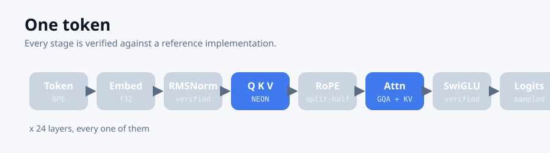
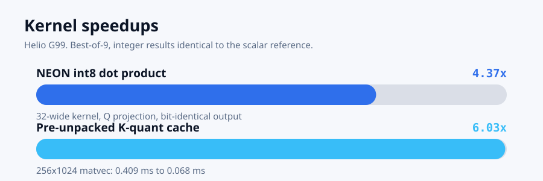
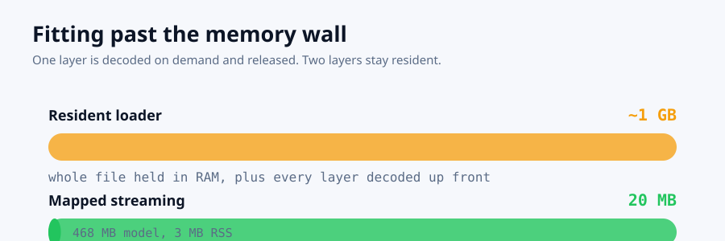

<div align="center">


# PortLLM

**An inference engine for the hardware you actually have.**

Not a model. Not a benchmark. A working engine that reads a prompt, writes an
answer, and tells you the truth about how fast it did it.

[](https://github.com/AbduljabbarBXR/portllm)
[](https://www.rust-lang.org)
[](LICENSE)

</div>

---

## The problem

You have a phone. It has 6 GB of RAM, a shared memory bus, a GPU you cannot
reach from a sandbox, and a storage controller that is fast until it is not.
Every LLM you are told to download assumes 24 GB of VRAM and a discrete GPU
somewhere else.

So you do not run one. You run the small one, badly, and you are told that is
just how it is.

**It is not.** The interesting question is not "which model fits" but **"what
does this specific device need in order to run a bigger one"** — and that
question has a different answer on every phone.

---

## What PortLLM does

<div align="center"></div>

It reads a GGUF model and generates text. Then it does the part that actually
matters on a phone: it measures the device, and it refuses to lie about what
fits.

```bash
portllm detect                                   # what hardware do I have?
portllm rec                                      # which models suit this phone?
portllm run model.gguf "The capital of France is"
```

<div align="center">

```
 Paris. It is the largest city in Europe and the second largest in the world
[16 tokens in 8.5s = 1.89 tok/s]
```

</div>

---

## Four things that are actually measured

Everything below was measured on a Helio G99 (8 cores, 5.6 GB RAM, ~1.2 GB
available, Android under Termux) and is reproducible with `cargo test --release`.
No number here is a projection.

<div align="center"></div>

### 1. NEON integer kernels — 4.37x

The inner loop of every projection is a 32-wide int8 dot product. That is
exactly what the vector unit is for.

The result is **bit-identical** to the scalar reference, and that is enforced
rather than assumed: an int8 dot product is exact integer arithmetic, so a
widened-and-accumulated NEON sum *must* equal the scalar sum exactly. A test
compares both paths on real layer weights. Any drift would silently change
which tokens win, and nothing else would notice.

### 2. Pre-unpacked K-quant cache — 6.03x

Dequantising the same weights on every token is the single most wasteful thing
a naive engine does. Unpack once, keep it, and the matvec drops from
**0.409 ms to 0.068 ms**.

### 2b. Vectorised unpack — 1.79x

The unpack itself is the most repeated work left: once per block, per layer,
per token. The inner loop splits each byte into two 4-bit weights that belong
to different sub-blocks — a pure reordering, so sixteen bytes go in and two
aligned halves come out.

The scale decode next to it **deliberately stayed scalar**. It is twelve reads
against 256 weight bytes, so vectorising it buys little and costs aliasing
hazard. Attempting it first also turned up a real trap worth recording:
NEON's 16-byte store always writes 16 bytes, so storing into a 12-byte scale
field corrupts the stack. The reasoning is recorded where the decision is
made.

### 2c. No allocation in the hot path — +38%

Every projection quantised its input into a freshly allocated pair of vectors,
and a layer has six projections, so a sixteen-token paragraph put roughly
**6,000 short-lived allocations** through the allocator. The buffers are now
thread-local, grow on first use, and are never shrunk.

Reuse is pinned rather than assumed: a test checks that requesting the same
width twice does not reallocate *and does not lose the contents*, and that a
narrower request does not shrink the buffer.

End to end: **1.37 → 1.89 tok/s.** That is a bigger win than an allocation
change should give, which is the argument for having counted where the time
went rather than guessing.

### 3. Streaming past the memory wall — 468 MB becomes 20 MB

<div align="center"></div>

The obvious loader reads the whole file into RAM and decodes every layer up
front: about 1 GB. That fits a 0.5B model and nothing else.

PortLLM maps the file instead and decodes **one layer at a time**, keeping two.
Peak residency falls to **20 MB**, and resident set size while generating is
**3 MB**.

That headroom is the whole point. A 4.2 GB sparse model does not fit 1.2 GB of
RAM — but if only 8 of its 64 experts run per token, and you decode on demand,
the model you could not load becomes the model you can run.

The arithmetic is unchanged, and a test proves it: layers are decoded through
both loaders and compared element-for-element. Same tokens out.

### 4. Sparse routing, verified against a real header

<div align="center"></div>

Read from an actual OLMoE model: **64 experts, top-8 selected, 16 layers**.

Two details decide whether a router is right or merely finite, and **both fail
silently**:

- **Normalising over the selection, not over all experts.** Normalise over 64
  and then keep 8, and every weight is capped at ⅛. The output is still finite.
  The model still generates fluent text. Nothing announces the bug.
- **Ties must break deterministically**, or the same input routes differently
  between runs and the model stops being reproducible.

---

## Honest limits

This section is the point of the rest of the document.

| | |
|---|---|
| **Dense generation** | ✅ works, 1.89 tok/s on the reference device |
| **NEON kernels** | ✅ measured, bit-identical |
| **Streaming** | ✅ measured, verified against the resident path |
| **MoE routing** | ✅ verified against a real header |
| **MoE expert execution** | ❌ **not verified** — see below |
| **Expert prefetch** | ❌ **not implemented** |
| **GPU / NPU dispatch** | ❌ **not implemented** |
| **Desktop** | ❌ **not implemented** |
| **Speed** | ⚠️ **slower than leading Android engines.** See below. |

### The sparse model was never run

The routing is verified. The experts are not executed, and prefetch is not
implemented. OLMoE-1B-7B's weights are 4.2 GB and this device has 1.2 GB
available.

Streaming removes the *memory* wall. It does not make a 4.2 GB file fast, and
without a sparse model that fits, there is no way here to measure whether
prefetching expert weights actually helps.

**So this project does not claim a breakthrough in sparse inference.** It
builds the two pieces such a claim would need — bounded residency and verified
routing — and stops.

### It is not yet fast

1.89 tok/s is slow. The best existing Android inference engines are roughly
2-3x faster on comparable hardware, because they pre-unpack K-quant weights for
the whole model once and then reuse them for every token, rather than paying a
per-layer unpack during the steady state.

PortLLM unpacks per layer and keeps a bounded window, which is what makes the
streaming mode possible at all. Two changes moved generation from 1.11 to 1.89
tok/s — vectorising the unpack, and removing six thousand heap allocations per
paragraph — but closing the rest of the gap means pre-packing weights across
layers, which trades the bounded residency that streaming exists to provide
for speed. **That is a real design tension, not an oversight, and it is not
resolved.**

So: the honest summary is that **PortLLM is a more transparent implementation
of the same arithmetic, plus a streaming layer and a verified router that the
faster engines do not have — and it is currently the slower of the two.**

---

## Why it is still worth looking at

Because it was built to be checked.

Every claim above has a test that fails when the claim stops being true.
Three of them exist because they caught real bugs during development:

- **A swapped scratch buffer.** The cached attention path wrote the *gate
  projection* into the buffer holding the *SwiGLU output*. Every generated
  token was confidently wrong. Nothing detected it — the original verified
  forward pass still passed, because the cache did not exist yet. The test
  that caught it compares the cached path against the verified one at every
  stage. That test is now the most valuable line in the repository.

- **Byte-fallback tokens decoded as stand-ins.** Output came out as
  `ä¹İä¹İä¹İ`. Byte-fallback vocabulary entries store the UTF-8 of a raw byte,
  and their characters are data, not the reversible alphabet. Decoding runs
  them through the alphabet and produces mojibake.

- **A correlated random number generator.** Plain xorshift leaves nearby seeds
  visibly similar: seeds 1 through 20 produced near-identical streams, so
  "cold" sampling picked the same token 19 times out of 20. Replaced with
  splitmix64.

And one benchmark was changed to **stop asserting a speedup**. It timed five
iterations and compared means, so a scheduler tick on a busy phone reported
the cache as 0.6x slower when it was 6x faster. It now reports best-of-nine
and says so when it loses.

A benchmark that cannot fail is not measuring anything. One that fails for the
wrong reason teaches people to ignore it.

---

## Architecture

```
src/
  gguf.rs       GGUF parser, quant block sizes, truncation detection
  kernel.rs     f16, Q4_K dequantisation, reference matvec
  unpack.rs     vectorised super-block unpack, pinned against the scalar path
  fast.rs       unpacked cache, int8 activation quantiser, NEON kernels
  ops.rs        RMSNorm, RoPE, softmax, SwiGLU, grouped-query attention
  model.rs      layer assembly, verified forward pass, KV cache, generation
  tokenizer.rs  GPT-2 byte-level BPE, read from the model's own metadata
  sampling.rs   seeded sampling, temperature, top-k, top-p
  moe.rs        sparse router: top-k selection and weighted combination
  stream.rs     read-only memory mapping, bounds-checked windows
  streaming.rs  layer-at-a-time decoding with a bounded resident window
  device.rs     hardware probe: cores, RAM, storage, accelerator reachability
  fit.rs        context-aware model fit scoring
  placement.rs  unified RAM / storage / GPU residency policy
  registry.rs   known model shapes
  validate.rs   non-finite value auditing across every entry point
```

**Zero dependencies.** `libc` is declared directly for `mmap`, `munmap` and
`madvise` so the crate stays dependency-free and the binary stays static and
small.

---

## Design notes

**The tokenizer is part of the model.** The vocabulary and the merge list are
read from the GGUF, so there is no second file to fall out of sync with the
weights. The byte-to-character alphabet is a bijection that is deliberately
*not* byte-identical — space becomes `U+0120` — and decoding inverts it, so
text round-trips exactly over arbitrary bytes.

**Residency is a policy, not a constant.** The placement planner sorts regions
by how often they are read per token, keeps the hot ones, and streams the
cold ones. It also refuses to place anything on a GPU the probe says cannot be
dispatched to, rather than building a beautiful schedule for hardware that is
not there.

**Sparsity is an opportunity, not an optimisation.** Dense models read every
weight on every token. Sparse models read 8 of 64. That difference is what
makes a streaming engine the right shape for MoE rather than a workaround.

---

## Status

`cargo test --release` — **149 tests, all passing.**

| | |
|---|---|
| Works end to end | prompt → text |
| Verified | 149 tests |
| Dependencies | none |
| Device support | any Linux/Android/aarch64; NEON checked at runtime |
| Licence | MIT |

Not yet: sparse execution, prefetch, GPU dispatch, desktop.

---

<div align="center">


**PortLLM** — an inference engine for the hardware you actually have.

<sub>Built and measured on an Android phone. Every claim in this document has a
test that fails when it stops being true.</sub>

</div>